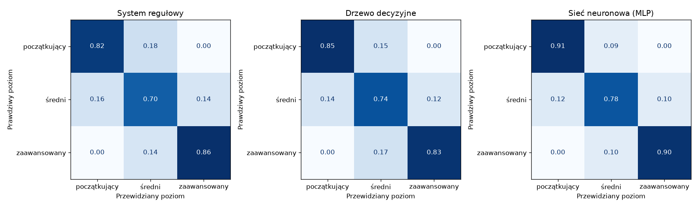
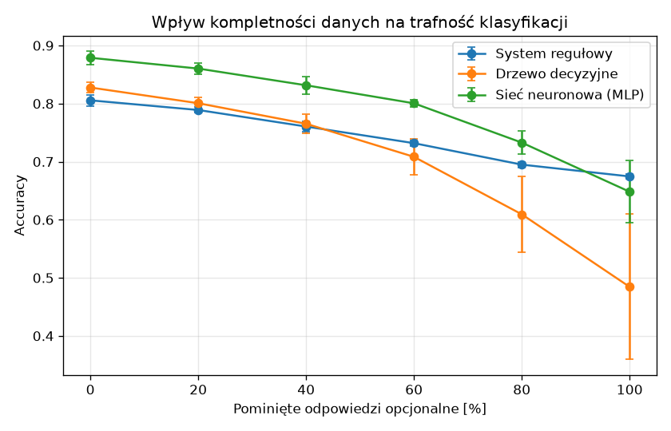

# Eksperymenty: porównanie klasyfikatorów sprawności

Opis klasyfikatorów i generatora danych: [ML.md](ML.md).
Kod: `experiments/evaluation.py` (eksperymenty), `experiments/run.py` (zapis wyników i wykresów).

## Metodyka

- Każdy eksperyment powtórzono dla 5 ziaren losowania (`seed` 1–5). Dla każdego ziarna
  wygenerowano nowy zbiór 5000 osób i podzielono go na część uczącą (75%) i testową (25%)
  z zachowaniem proporcji poziomów. Wyniki podano jako średnią ± odchylenie standardowe.
- Klasyfikatory ML uczą się na danych, w których 20% odpowiedzi opcjonalnych jest pominiętych
  (typowa kompletność kwestionariusza).
- Metryki:
  - **accuracy:** odsetek poprawnych klasyfikacji,
  - **F1 makro:** średnia miar F1 dla trzech poziomów (każdy poziom ma tę samą wagę),
  - **macierz pomyłek:** jaka część osób z danego poziomu trafiła do każdej klasy,
  - **czas uczenia** i **czas klasyfikacji jednej osoby** (odpowiada jednemu żądaniu API).
- Wszystkie przebiegi są zapisywane w MLflow (eksperymenty `porownanie-klasyfikatorow`
  i `wplyw-kompletnosci`).

Odtworzenie wyników:

```bash
pip install -r requirements-dev.txt
python -m experiments.run      # ok. 30 s, wyniki w docs/experiments/
mlflow ui                      # przeglądanie przebiegów: http://127.0.0.1:5000
```

## Eksperyment 1: porównanie klasyfikatorów

Dane testowe z 20% pominiętych odpowiedzi opcjonalnych (`docs/experiments/comparison.csv`).

| Klasyfikator       | Accuracy        | F1 makro        | Czas uczenia | Czas klasyfikacji 1 osoby |
|--------------------|-----------------|-----------------|--------------|---------------------------|
| System regułowy    | 0,792 ± 0,003   | 0,792 ± 0,003   | —            | 0,02 ms                   |
| Drzewo decyzyjne   | 0,808 ± 0,007   | 0,808 ± 0,006   | 0,01 s       | 0,44 ms                   |
| Sieć neuronowa     | 0,866 ± 0,012   | 0,864 ± 0,012   | 0,13 s       | 0,53 ms                   |



**Obserwacje:**

1. Sieć neuronowa osiąga najwyższą trafność, o ok. 7 punktów procentowych wyższą od systemu
   regułowego i o ok. 6 p.p. wyższą od drzewa decyzyjnego.
2. Żaden klasyfikator nie pomylił poziomu początkującego z zaawansowanym (zera w rogach macierzy).
   Błędy dotyczą wyłącznie poziomów sąsiednich. Ma to znaczenie dla bezpieczeństwa:
   osoba początkująca nie dostanie planu dla zaawansowanych.
3. Najtrudniejszy do rozpoznania jest poziom średni (70–78% poprawnych), bo graniczy z oboma
   pozostałymi.
4. Czas klasyfikacji jednej osoby jest poniżej 1 ms dla wszystkich metod, więc wybór
   klasyfikatora nie wpływa na czas odpowiedzi API.

## Eksperyment 2: wpływ kompletności danych

Te same osoby testowe oceniane przy coraz większym odsetku pominiętych odpowiedzi opcjonalnych
(staż i cztery testy sprawności). Przy 100% zostają tylko dane podstawowe: wiek, płeć, BMI
i poziom aktywności (`docs/experiments/completeness.csv`).

| Pominięte odpowiedzi | System regułowy | Drzewo decyzyjne | Sieć neuronowa  |
|----------------------|-----------------|------------------|-----------------|
| 0%                   | 0,806 ± 0,009   | 0,828 ± 0,009    | 0,879 ± 0,011   |
| 20%                  | 0,789 ± 0,005   | 0,801 ± 0,010    | 0,860 ± 0,010   |
| 40%                  | 0,760 ± 0,009   | 0,765 ± 0,016    | 0,832 ± 0,016   |
| 60%                  | 0,732 ± 0,005   | 0,708 ± 0,031    | 0,800 ± 0,007   |
| 80%                  | 0,695 ± 0,005   | 0,609 ± 0,066    | 0,733 ± 0,020   |
| 100%                 | 0,675 ± 0,004   | 0,484 ± 0,125    | 0,648 ± 0,054   |



**Obserwacje:**

1. Trafność wszystkich metod spada wraz z ubywaniem danych. Wyniki testów sprawności niosą
   istotną informację, której nie zastąpią same dane podstawowe.
2. Do ok. 60% braków sieć neuronowa pozostaje najlepsza.
3. System regułowy traci trafność najwolniej i przy samych danych podstawowych (100% braków)
   jest najlepszy. Reguły pomijają brakujące wskaźniki, a modele ML uczone przy 20% braków
   trafiają na dane wyraźnie inne niż w czasie uczenia.
4. Drzewo decyzyjne jest najbardziej wrażliwe na braki: przy 100% braków trafność spada do
   0,48 i silnie zależy od losowania (odchylenie 0,125). Gdy brakuje cechy z górnych podziałów
   drzewa, wszystkie osoby trafiają do gałęzi wybranej przez wartość wstawioną (medianę).

**Wniosek projektowy:** przy niskiej kompletności danych bezpieczniej jest korzystać z systemu
regułowego albo poinformować użytkownika, że wynik jest mało wiarygodny. API zwraca w tym celu
kompletność danych (`data_completeness`) razem z wynikiem klasyfikacji.

## Ograniczenia

- Dane są syntetyczne, więc wyniki porównują metody w kontrolowanych warunkach przyjętego
  modelu generowania, a nie trafność na prawdziwych użytkownikach.
- Braki danych są losowe i niezależne od siebie. W rzeczywistości użytkownicy mogą częściej
  pomijać konkretne testy (np. osoby słabsze – pompki), co może zmienić wyniki.
- Czasy zmierzono na jednym komputerze deweloperskim i służą wyłącznie do porównania metod.
