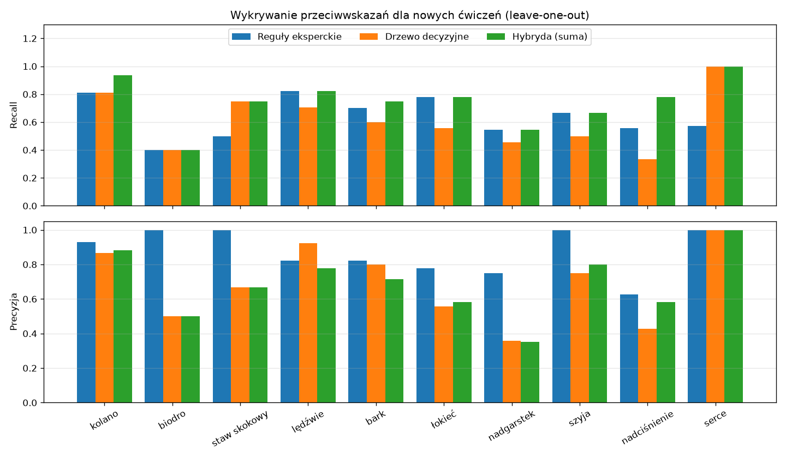
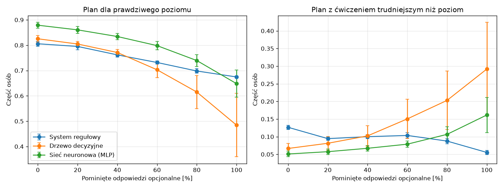

# Eksperymenty: porównanie klasyfikatorów sprawności

Opis klasyfikatorów i generatora danych: [ML.md](ML.md).
Kod: `experiments/evaluation.py` (eksperymenty), `experiments/run.py` (zapis wyników i wykresów).

## Metodyka

- Każdy eksperyment powtórzono dla 5 ziaren losowania (`seed` 1–5). Dla każdego ziarna
  wygenerowano nowy zbiór 5000 osób i podzielono go na część uczącą (75%) i testową (25%)
  z zachowaniem proporcji poziomów. Wyniki podano jako średnią ± odchylenie standardowe.
- Klasyfikatory ML uczą się na danych, w których 20% odpowiedzi opcjonalnych jest pominiętych
  (typowa kompletność kwestionariusza).
- Metryki:
  - **accuracy:** odsetek poprawnych klasyfikacji,
  - **F1 makro:** średnia miar F1 dla trzech poziomów (każdy poziom ma tę samą wagę),
  - **macierz pomyłek:** jaka część osób z danego poziomu trafiła do każdej klasy,
  - **czas uczenia** i **czas klasyfikacji jednej osoby** (odpowiada jednemu żądaniu API).
- Wszystkie przebiegi są zapisywane w MLflow (eksperymenty `dobor-hiperparametrow`,
  `porownanie-klasyfikatorow`, `wplyw-kompletnosci`, `wykrywanie-przeciwwskazan` i `jakosc-planu`).

Odtworzenie wyników:

```bash
pip install -r requirements-dev.txt
python -m experiments.run      # ok. 1 min, wyniki w docs/experiments/
mlflow ui                      # przeglądanie przebiegów: http://127.0.0.1:5000
```

## Dobór hiperparametrów

**Pytanie:** jakie ustawienia modeli ML (głębokość drzewa, rozmiar sieci) przyjąć?

**Metodyka** (`experiments/tuning.py`):
- Przeszukiwanie siatki (`GridSearchCV`) z 5-krotną walidacją krzyżową: dane uczące dzielone są
  na 5 części, model uczy się na 4 i jest oceniany na piątej, kolejno dla każdej części.
- Dane: część ucząca zbioru z `seed = 42` (3750 osób, 20% braków), ten sam zbiór co przy uczeniu
  modeli dla aplikacji. Dane testowe nie biorą udziału w doborze, więc nie zawyżają późniejszej oceny.
- Miara: F1 makro (średnia ± odchylenie z 5 części).
- Siatki: drzewo – głębokość {3, 4, 6, 8, 10, bez limitu} × min. próbek w liściu {1, 5, 20, 50};
  sieć – warstwy ukryte {(16), (32), (32, 16), (64, 32)} × regularyzacja L2 `alpha` {0,0001; 0,001; 0,01}.
- Wybór według **reguły jednego odchylenia standardowego**: spośród ustawień, których wynik jest
  gorszy od najlepszego o mniej niż jego odchylenie standardowe, wybiera się najprostsze. Różnica
  mniejsza niż odchylenie mieści się w losowej zmienności, a prostszy model łatwiej zinterpretować
  i trudniej go przeuczyć.

Wyniki (`docs/experiments/tuning.csv`, pięć najlepszych ustawień każdego modelu):

| Model            | Ustawienia                            | F1 makro (CV)   |
|------------------|---------------------------------------|-----------------|
| Drzewo decyzyjne | głębokość 10, min. 5 w liściu         | 0,816 ± 0,009   |
| Drzewo decyzyjne | głębokość 8, min. 5 w liściu          | 0,814 ± 0,013   |
| Drzewo decyzyjne | bez limitu, min. 5 w liściu           | 0,811 ± 0,013   |
| Drzewo decyzyjne | głębokość 10, min. 1 w liściu         | 0,810 ± 0,008   |
| Drzewo decyzyjne | **głębokość 6, min. 5 w liściu**      | **0,809 ± 0,008** |
| Sieć neuronowa   | **(32, 16), alpha 0,0001**            | **0,860 ± 0,008** |
| Sieć neuronowa   | (32, 16), alpha 0,001                 | 0,858 ± 0,006   |
| Sieć neuronowa   | (32, 16), alpha 0,01                  | 0,857 ± 0,007   |
| Sieć neuronowa   | (64, 32), alpha 0,01                  | 0,855 ± 0,021   |
| Sieć neuronowa   | (16), alpha 0,001                     | 0,851 ± 0,016   |

**Wnioski:**

1. **Sieć neuronowa:** wstępnie przyjęte ustawienia (32 i 16 neuronów, `alpha` 0,0001) okazały się
   najlepsze. Sieć z jedną warstwą wypada wyraźnie gorzej, a większa (64, 32) nie daje poprawy.
2. **Drzewo decyzyjne:** najlepsze jest drzewo o głębokości 10 (0,816), ale drzewo o głębokości 6
   mieści się w granicy jednego odchylenia (próg 0,807), a ma do 16 razy mniej liści, więc jego
   reguły da się przeczytać. Wstępne ustawienie (min. 20 próbek w liściu, 0,799) było poza tą
   granicą, dlatego zmieniono je na **min. 5 próbek w liściu**.
3. Na zbiorach testowych zmiana drzewa nie przyniosła wyraźnej poprawy (accuracy 0,806 wobec
   0,808 wcześniej, w granicach odchylenia), więc dobór parametrów potwierdza przede wszystkim,
   że wyniki porównania nie wynikają z przypadkowo złych ustawień modeli.

## Eksperyment 1: porównanie klasyfikatorów

Dane testowe z 20% pominiętych odpowiedzi opcjonalnych (`docs/experiments/comparison.csv`).

| Klasyfikator       | Accuracy        | F1 makro        | Czas uczenia | Czas klasyfikacji 1 osoby |
|--------------------|-----------------|-----------------|--------------|---------------------------|
| System regułowy    | 0,792 ± 0,003   | 0,792 ± 0,003   | —            | 0,02 ms                   |
| Drzewo decyzyjne   | 0,806 ± 0,010   | 0,806 ± 0,011   | 0,01 s       | 0,41 ms                   |
| Sieć neuronowa     | 0,866 ± 0,012   | 0,864 ± 0,012   | 0,14 s       | 0,52 ms                   |


**Obserwacje:**

1. Sieć neuronowa osiąga najwyższą trafność, o ok. 7 punktów procentowych wyższą od systemu
   regułowego i o ok. 6 p.p. wyższą od drzewa decyzyjnego.
2. Żadna osoba początkująca nie została zaklasyfikowana jako zaawansowana. Pomyłka odwrotna
   (zaawansowany uznany za początkującego) zdarzyła się sporadycznie: 0,1–0,2% osób, czyli kilka
   na ok. 2000 zaawansowanych. Pozostałe błędy dotyczą poziomów sąsiednich. Ma to znaczenie dla
   bezpieczeństwa: osoba początkująca nie dostanie planu dla zaawansowanych.
3. Najtrudniejszy do rozpoznania jest poziom średni (70–78% poprawnych), bo graniczy z oboma
   pozostałymi.
4. Czas klasyfikacji jednej osoby jest poniżej 1 ms dla wszystkich metod, więc wybór
   klasyfikatora nie wpływa na czas odpowiedzi API.

## Eksperyment 2: wpływ kompletności danych

Te same osoby testowe oceniane przy coraz większym odsetku pominiętych odpowiedzi opcjonalnych
(staż i cztery testy sprawności). Przy 100% zostają tylko dane podstawowe: wiek, płeć, BMI
i poziom aktywności (`docs/experiments/completeness.csv`).

| Pominięte odpowiedzi | System regułowy | Drzewo decyzyjne | Sieć neuronowa  |
|----------------------|-----------------|------------------|-----------------|
| 0%                   | 0,806 ± 0,009   | 0,825 ± 0,013    | 0,879 ± 0,011   |
| 20%                  | 0,789 ± 0,005   | 0,798 ± 0,012    | 0,860 ± 0,010   |
| 40%                  | 0,760 ± 0,009   | 0,765 ± 0,014    | 0,832 ± 0,016   |
| 60%                  | 0,732 ± 0,005   | 0,710 ± 0,031    | 0,800 ± 0,007   |
| 80%                  | 0,695 ± 0,005   | 0,610 ± 0,065    | 0,733 ± 0,020   |
| 100%                 | 0,675 ± 0,004   | 0,484 ± 0,125    | 0,648 ± 0,054   |


**Obserwacje:**

1. Trafność wszystkich metod spada wraz z ubywaniem danych. Wyniki testów sprawności niosą
   istotną informację, której nie zastąpią same dane podstawowe.
2. Do ok. 60% braków sieć neuronowa pozostaje najlepsza.
3. System regułowy traci trafność najwolniej i przy samych danych podstawowych (100% braków)
   jest najlepszy. Reguły pomijają brakujące wskaźniki, a modele ML uczone przy 20% braków
   trafiają na dane wyraźnie inne niż w czasie uczenia.
4. Drzewo decyzyjne jest najbardziej wrażliwe na braki: przy 100% braków trafność spada do
   0,48 i silnie zależy od losowania (odchylenie 0,125). Gdy brakuje cechy z górnych podziałów
   drzewa, wszystkie osoby trafiają do gałęzi wybranej przez wartość wstawioną (medianę).

**Wniosek projektowy:** przy niskiej kompletności danych bezpieczniej jest korzystać z systemu
regułowego albo poinformować użytkownika, że wynik jest mało wiarygodny. API zwraca w tym celu
kompletność danych (`data_completeness`) razem z wynikiem klasyfikacji.

## Eksperyment 3: wykrywanie przeciwwskazań dla nowych ćwiczeń

**Pytanie:** czy przeciwwskazania ćwiczenia da się przewidzieć z jego cech (wzorzec ruchu,
grupa mięśniowa, sprzęt, trudność), np. przy dodawaniu do atlasu nowego ćwiczenia?

**Metodyka:**
- Wzorzec: ręczne etykiety przeciwwskazań 67 ćwiczeń atlasu (`app/data/exercises.json`).
- Walidacja krzyżowa *leave-one-out*: każde ćwiczenie po kolei jest traktowane jak nowe,
  a detektor uczy się na pozostałych 66.
- Każda para (ćwiczenie, ograniczenie) to jedna decyzja binarna, łącznie 670 decyzji
  (108 przeciwwskazań w atlasie). Metryki: precyzja, recall, F1 (mikro) oraz liczba
  przeoczonych przeciwwskazań i fałszywych alarmów.
- Porównane detektory (`app/ml/contraindication_detection.py`):
  - **reguły eksperckie:** 5 reguł opartych na budowie ćwiczenia (np. przysiad → kolano,
    sztanga w ciężkich ćwiczeniach → lędźwie i nadciśnienie, ćwiczenia dynamiczne → serce),
  - **drzewo decyzyjne** uczone na atlasie (klasyfikacja wieloetykietowa, cechy one-hot),
  - **hybryda:** suma wyników reguł i drzewa.

Wyniki (`docs/experiments/contraindications.csv`):

| Detektor           | Precyzja | Recall | F1    | Przeoczone | Fałszywe alarmy | Całe ćwiczenie poprawnie |
|--------------------|----------|--------|-------|------------|-----------------|--------------------------|
| Reguły eksperckie  | 0,839    | 0,676  | 0,749 | 35         | 14              | 46%                      |
| Drzewo decyzyjne   | 0,701    | 0,630  | 0,663 | 40         | 29              | 39%                      |
| Hybryda (suma)     | 0,680    | 0,769  | 0,722 | 25         | 39              | 33%                      |



**Obserwacje:**

1. Reguły eksperckie mają najlepszą precyzję i F1. Przy 67 przykładach drzewo nie ma z czego
   nauczyć się zależności, które ekspert zapisuje w kilku regułach.
2. Drzewo wygrywa tam, gdzie zależność jest prosta i spójna w atlasie: choroba serca
   (recall 1,00 wobec 0,57 reguł) i staw skokowy.
3. Hybryda ma najwyższy recall (0,769, o 10 przeoczeń mniej niż reguły) kosztem precyzji.
   W kontekście bezpieczeństwa to korzystna wymiana: fałszywy alarm tylko zawęża wybór
   ćwiczeń, a przeoczenie oznacza ryzyko kontuzji.
4. Żadna metoda nie jest wystarczająco dokładna, by działać bez człowieka: nawet hybryda
   przeocza ok. 1/4 przeciwwskazań. Najsłabiej wykrywane są biodro i nadgarstek, które zależą
   od szczegółów techniki, a nie od ogólnych cech ćwiczenia.
5. Górną granicę trafności wyznaczają same dane: 14 z 67 ćwiczeń ma identyczne cechy jak inne
   ćwiczenie, a różne przeciwwskazania (np. przysiad goblet i przysiad sumo z kettlebell
   różnią się obciążeniem biodra). Żadna metoda oparta na tych cechach nie rozróżni ich.

**Wniosek projektowy:** w aplikacji detektor hybrydowy służy wyłącznie jako **podpowiedź**
przy dodawaniu ćwiczenia (`POST /api/v1/exercises/suggest-contraindications`). Plan treningowy
korzysta zawsze z przeciwwskazań zatwierdzonych przez człowieka, więc filtr bezpieczeństwa
w planie nie przepuszcza żadnego ćwiczenia przeciwwskazanego według atlasu.

## Eksperyment 4: jakość planu a kompletność danych

**Pytanie:** jak błędy klasyfikacji przy brakach danych przekładają się na plan treningowy?

**Metodyka** (`experiments/plan_quality.py`):
- Osoby testowe i braki danych jak w eksperymencie 2. Każda osoba dostaje losowe preferencje:
  cel, 2–5 dni treningowych, 30–90 minut, dostępny sprzęt (każdy rodzaj z prawdopodobieństwem 50%)
  i u połowy osób jedno lub dwa ograniczenia zdrowotne.
- Dla każdej osoby generator buduje **plan wzorcowy** (dla prawdziwego poziomu) i plan dla poziomu
  przewidzianego przez klasyfikator. Atlas: 67 ćwiczeń z `app/data/exercises.json`.
- Metryki:
  - **plan dla prawdziwego poziomu:** część osób, których plan jest identyczny z wzorcowym,
  - **plan za trudny / za łatwy:** plan zbudowany dla wyższego / niższego poziomu,
  - **ćwiczenie trudniejsze niż poziom:** część osób, w których planie jest co najmniej jedno
    ćwiczenie o trudności wyższej niż ich prawdziwy poziom (miara ryzyka przeciążenia),
  - **podobieństwo ćwiczeń:** średni indeks Jaccarda zbiorów ćwiczeń obu planów
    (część wspólna / suma, 1 oznacza identyczny dobór ćwiczeń),
  - **ćwiczenia przeciwwskazane:** liczba ćwiczeń w planach sprzecznych z ograniczeniami osoby.

Wyniki: średnia z 5 ziaren (`docs/experiments/plan_quality.csv`).

| Pominięte odpowiedzi | Klasyfikator     | Plan dla prawdziwego poziomu | Za trudny | Za łatwy | Ćwiczenie trudniejsze niż poziom | Podobieństwo ćwiczeń |
|----------------------|------------------|------------------------------|-----------|----------|----------------------------------|----------------------|
| 0%                   | System regułowy  | 0,806                        | 0,149     | 0,045    | 0,127                            | 0,935                |
| 0%                   | Drzewo decyzyjne | 0,825                        | 0,081     | 0,094    | 0,067                            | 0,943                |
| 0%                   | Sieć neuronowa   | 0,879                        | 0,061     | 0,060    | 0,051                            | 0,961                |
| 60%                  | System regułowy  | 0,732                        | 0,125     | 0,143    | 0,104                            | 0,909                |
| 60%                  | Drzewo decyzyjne | 0,703                        | 0,168     | 0,129    | 0,150                            | 0,901                |
| 60%                  | Sieć neuronowa   | 0,798                        | 0,093     | 0,109    | 0,079                            | 0,933                |
| 100%                 | System regułowy  | 0,675                        | 0,068     | 0,257    | 0,055                            | 0,886                |
| 100%                 | Drzewo decyzyjne | 0,484                        | 0,315     | 0,200    | 0,292                            | 0,820                |
| 100%                 | Sieć neuronowa   | 0,648                        | 0,180     | 0,172    | 0,161                            | 0,882                |

We wszystkich przebiegach liczba ćwiczeń przeciwwskazanych wyniosła **0**.



**Obserwacje:**

1. **Bezpieczeństwo nie zależy od kompletności danych.** Ograniczenia zdrowotne są pytaniem
   obowiązkowym, a filtr przeciwwskazań działa niezależnie od klasyfikatora, więc żaden plan nie
   zawierał ćwiczenia przeciwwskazanego, nawet przy błędnie wyznaczonym poziomie.
2. **Błędny poziom zmienia plan w niewielkim stopniu.** Nawet przy samych danych podstawowych
   plany mają 82–89% wspólnych ćwiczeń z planem wzorcowym. Ćwiczenia dla poziomu niższego są
   dostępne także na wyższych poziomach, więc pomyłka o jeden poziom zmienia tylko część ćwiczeń
   (i liczbę serii u początkujących).
3. **Kierunek błędu zależy od metody.** System regułowy przy brakach danych częściej zaniża poziom
   (przy 100% braków 26% planów za łatwych i tylko 6% z ćwiczeniem za trudnym). Drzewo decyzyjne
   myli się w obie strony, a przy 100% braków aż 29% osób dostaje ćwiczenie trudniejsze niż ich
   poziom. Z punktu widzenia bezpieczeństwa plan za łatwy jest lepszy niż za trudny.
4. Przy pełnych danych system regułowy częściej zawyża poziom (15% planów za trudnych) niż modele
   ML (6–8%). Progi reguł są więc dla tej populacji zbyt łagodne, co wskazuje kierunek ich korekty.
5. Do ok. 60% braków sieć neuronowa daje plany najbliższe wzorcowym i najrzadziej za trudne.

**Wniosek projektowy:** przy kompletnych danych najlepsze plany daje sieć neuronowa, a przy
bardzo niekompletnych system regułowy, który myli się „w bezpieczną stronę”. Uzasadnia to
domyślny wybór sieci neuronowej i informowanie użytkownika o niskiej kompletności danych.

## Ograniczenia

- Etykiety przeciwwskazań w atlasie i reguły eksperckie pochodzą od autora systemu,
  a nie od niezależnego eksperta (fizjoterapeuty), co może zawyżać wyniki reguł.
- Dane są syntetyczne, więc wyniki porównują metody w kontrolowanych warunkach przyjętego
  modelu generowania, a nie trafność na prawdziwych użytkownikach.
- Braki danych są losowe i niezależne od siebie. W rzeczywistości użytkownicy mogą częściej
  pomijać konkretne testy (np. osoby słabsze – pompki), co może zmienić wyniki.
- W eksperymencie 4 preferencje osób są losowane niezależnie od ich sprawności, a jakość planu
  oceniana jest względem planu wzorcowego z tego samego generatora, a nie przez trenera.
- Czasy zmierzono na jednym komputerze deweloperskim i służą wyłącznie do porównania metod.
